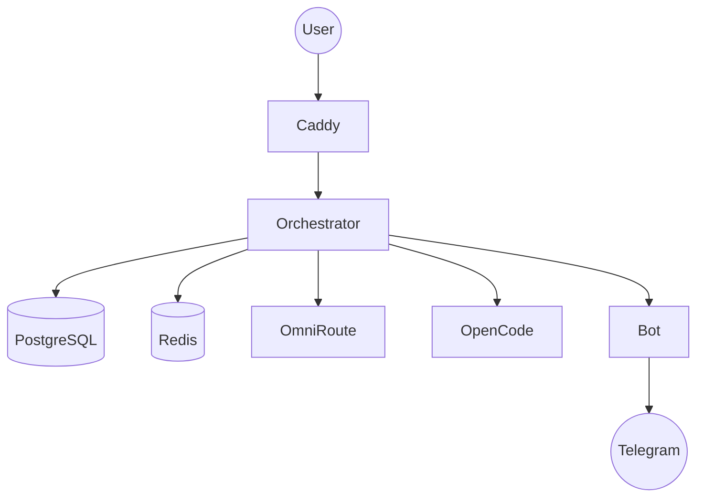

# Arox-Ai

## 1. Introduction
Arox-Ai is a comprehensive AI-powered workforce orchestration platform designed to automate coding tasks, manage AI model routing, and facilitate intelligent bot interactions.

## 2. Features
- **Intelligent Orchestration**: Manages complex AI coding workflows.
- **Model Routing**: Advanced routing to various AI models via OmniRoute.
- **Automated Workflows**: Integration with n8n for task automation and error alerting.
- **AI-Powered Coding**: Enhanced coding capabilities with OpenCode v2.0.0.
- **Persistence & Caching**: Uses PostgreSQL for data and Redis for caching.

## 3. System Architecture


## 4. Prerequisites
- Docker and Docker Compose
- AWS CLI configured for parameter retrieval
- Minimum hardware/resource limits as defined in `docker-compose.yml`

## 5. Installation
The project is designed to run in a controlled environment.
1. Ensure the repository is cloned to `/opt/arox`.
2. Ensure required secrets are populated in AWS SSM under `/arox/`.

## 6. Configuration
Configuration is managed via environment variables sourced from AWS SSM during deployment. See `docker-compose.yml` for required variables (API keys, database credentials, etc.).

## 7. Deployment
Deployment is performed using the provided script:
```bash
sudo bash /opt/arox/start.sh
```
This script retrieves parameters from AWS SSM, creates a temporary `.env` file, and executes `docker compose up -d --build`.

## 8. Usage
- **Coding Tasks**: Triggered via API requests to the orchestrator.
- **Monitoring**: Check logs via `docker compose logs -f <service_name>`.
- **Status**: `/code status` or `/code status <job_id>` for task tracking.

## 9. CI/CD Pipeline
The project utilizes GitHub Actions for continuous integration, focusing on linting and security auditing (`ruff`, `bandit`).

## 10. Development & Contributing
Contributions should follow the established workflow:
1. Create a feature branch from `main`.
2. Ensure changes pass CI/CD checks.
3. Submit a pull request for review.

## 11. Troubleshooting
- Check service health via `docker compose ps`.
- Examine container logs for errors.
- Ensure SSM parameters are correctly set and accessible.

## 12. Security
- Services run with `restart: unless-stopped`.
- OpenCode runs as a non-root user with constrained capabilities (`cap_drop: ALL`).
- Database and secrets are protected via environment-specific configurations.

## 13. License
Proprietary. All rights reserved.

## 14. Contact/Support
Contact the maintainers via the internal communications channel defined in the team documentation.
